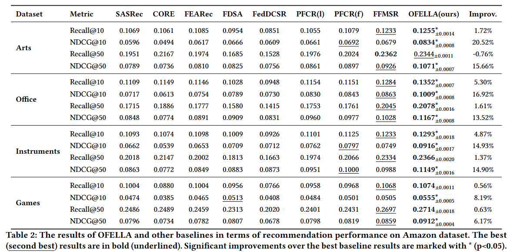

# OFELLA
**OFELLA: Optimizing Federated Cross-Domain Sequential
Recommendation with Efficient LLM Adaptation**   

Federated Cross-Domain Sequential Recommender System has
been one of the most promising approaches to enhance the recom-
mendation performance for various product domains effectively
while conforming to privacy protocols and resource limitations
under federated settings. Existing studies in this area, however,
are rather limited, as they rely heavily on overlapping users or
items across domains, and overlook the communication efficiency
and privacy preservation among different clients. In light of re-
cent progress in specialized and lightweight LLM-based embedding
models, we propose an innovative federated learning framework
OFELLA, empowered by LLMs for cross-domain recommendation.
Specifically, we incorporate P-tuning with prompting templates to
adapt LLMs’ world knowledge to be task- and domain-compatible.
Next, we avoid any explicit item or user-level information trans-
mission by compressing domain-specific knowledge into learnable
prefix instructions and tunable LLM adapters. Lastly, we enhance
the communication efficiency by integrating prefix instructions
and tunable adapters on the server side, and guiding the fusion
process with general instructions across all domains. As a result,
the local efficient adapter-tuning and global dynamic knowledge
aggregation will jointly contribute to the superior performance of
our proposed model, which we demonstrate through extensive ex-
periments conducted across various settings. Specifically, we show
that our method significantly outperforms existing state-of-the-art
baseline methods, as well as achieving numerous benefits in privacy
preservation and communication efficiency.


## Requirements

```
pip install -r requirements.txt
```

## Dataset
Download the raw Amazon dataset from [Amazon](https://cseweb.ucsd.edu/~jmcauley/datasets/amazon_v2/) and the [UK Ecommerce Dataset](https://www.kaggle.com/datasets/carrie1/ecommerce-data), putting them under `dataset/raw` and `dataset/uk_commerce` directory respectively. The resulting folders look as follow:
```js
raw/
├── Metadata
│   ├── meta_Arts_Crafts_and_Sewing.json.gz
│   ├── meta_Musical_Instruments.json.gz
│   ├── meta_Office_Products.json.gz
│   ├── meta_Prime_Pantry.json.gz
│   └── meta_Video_Games.json.gz
└── Ratings
    ├── Arts_Crafts_and_Sewing.csv
    ├── Musical_Instruments.csv
    ├── Office_Products.csv
    ├── Prime_Pantry.csv
    └── Video_Games.csv
uk_commerce/
└── data-utf8.csv
```

To construct the actual training/validation/testing dataset, run the following commands to process Amazon and UK Ecommerce dataset:

```bash
# --dataset: Arts, Office, Instruments, Games, Pantry
python3 original_preprocess_llm_text.py --dataset Arts --input_path ../raw/ --output_path ../norm/ --gpu_id 0 --plm_name Qwen/Qwen3-Embedding-0.6B
python3 original_preprocess_llm_or_text.py --dataset OR --input_path ../uk_commerce/ --output_path ../norm/ --gpu_id 0 --plm_name Qwen/Qwen3-Embedding-0.6B
```

## Federated Training

```bash
python3 fedtrain_lp_rec.py
```
Adjust the relevant configuration in `props/OFELLA.yaml` if needed:

Here are some important parameters in `props/OFELLA.yaml` you may need to modify:

1.`data_path`: The path of the dataset used for for federated training.

2.LoRA configuration: LoRA parameters used in the LLMs.
```yaml
lora_r: 16
lora_alpha: 32
lora_dropout: 0.1
# Name of target modules might be different in various LLM architectures
lora_target_modules: ["self_attn.q_proj","self_attn.k_proj", "self_attn.v_proj", "self_attn.o_proj", "mlp.up_proj", "mlp.down_proj"]
```

3.`base_model_name`: the name of the backbone LLM, the backbone should be identical or homologous with the LLM used for dataset preprocessing above.

### Results Analysis


By default, the testing will be conducted at the end of training, the metric curves are also recorded with tensorboard and wandb if it's turning on. 
```yaml
log_wandb: True
wandb_project: '[Project Name]'
```
